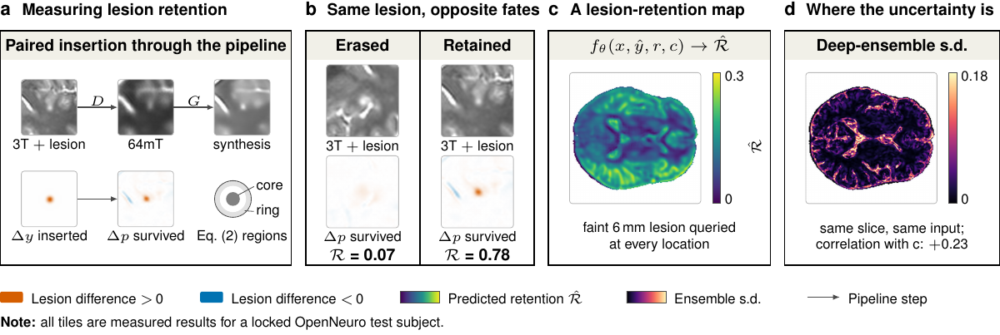
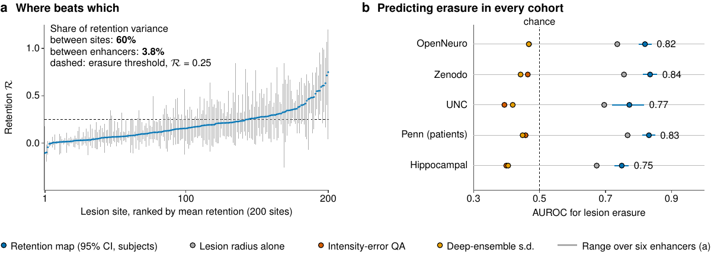
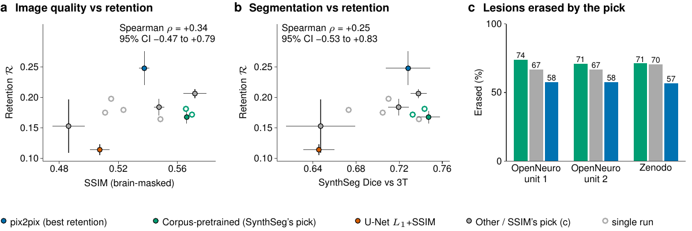

# Focal Signal Preservation in Ultra-Low-Field MRI Synthesis

Code for *A Controlled Perturbation Framework for Evaluating Focal Signal Preservation in
Ultra-Low-Field MRI Synthesis*.

Global metrics (SSIM, PSNR, segmentation Dice) cannot show whether a small focal abnormality
survives 64 mT → 3T synthesis. The framework inserts synthetic lesions of known size and signed
contrast into 3T images. Lesioned and lesion-free images then pass through the same learned
degradation operator `D` and enhancer `G`. **Signed retention** separates contrast attenuation from
polarity inversion, and a **retention map** predicts where lesions are erased.



## Findings

| | finding | figure / table |
|---|---|---|
| 1 | **Location outweighs the enhancer.** The site explains 60% of the variance in retention, and the enhancer explains 3.8%. | Fig. 2a |
| 2 | **Erasure is predictable, but not from uncertainty.** The retention map reaches AUROC 0.75–0.84 in every cohort. Intensity-error QA and ensemble s.d. score below chance. | Fig. 2b, Table 2 |
| 3 | **Cross-contrast synthesis inverts polarity.** Synthesised T1 takes lesion polarity from the T2 input. It inverts 83–92% of synthetic lesions and 82–97% of real MS lesions that are bright in both T1 and T2. | Fig. 3, Table 3 |
| 4 | **Global metrics select the wrong enhancers.** Selecting by SynthSeg Dice picks enhancers that erase 13–16 pp more synthetic lesions and 13–24 pp more real MS lesions. | Fig. 4, Fig. 5 |

Validation covers 12 enhancer configurations (36 models) and 69 held-out subjects from five public
cohorts. The framework's assumptions are checked against acquired 64 mT anatomy, an independent
operator (H2LO), 534 real MS lesions, 684 real stroke lesions, and the released SynthSR, SuperSynth
and GAMBAS models.

<p align="center">
 
</p>

## Layout

```
ulfkit/          data access, networks, metrics, training loop, volume preprocessing
exp/             experiments (one script per analysis) and the drivers run_*.sh
splits/          subject split of the development cohort (seed 0, age-stratified)
paper/figures/   scripts that write every table, plot and image tile of the paper from out_public/
assets/          rendered figures for this README
```

## Setup

```bash
pip install -r requirements.txt      # Python 3.10, PyTorch 2.6, one CUDA GPU (24 GB was used)
export FREESURFER_HOME=/path/to/freesurfer   # FreeSurfer 8.2: SynthStrip, SynthMorph, SynthSeg, SynthSR
```

Run every command from the repository root. The drivers use `$PYTHON` (default `python`).

## Data

All data are public. Place raw downloads under `datasets/raw/`.

| role | dataset | subjects | directory |
|---|---|---|---|
| development + internal test (64 mT unit 1 and 2, 3T) | [OpenNeuro ds006557](https://doi.org/10.18112/openneuro.ds006557.v1.0.2) | 15 / 3 / 5 | `ds006557/` |
| external, paired 64 mT + 3T | [Zenodo 20281403](https://doi.org/10.5281/zenodo.20281403) | 11 | `zenodo_v5/` |
| external, 3T only (UNC, Penn epilepsy, Hippocampal) | [MRI-PairedField](https://doi.org/10.5281/zenodo.22816860) | 10 / 23 / 20 | `mri_pairedfield/` |
| corpus pretraining | [IXI](https://brain-development.org/ixi-dataset/) Hammersmith | 185 | `ixi/` |
| real MS lesions | Muslim et al. 2022 | 60 | `ms_muslim/` |
| real stroke lesions (data-use agreement) | ATLAS R3.0 (Liew et al. 2022) | 1,453 sessions | `atlas/R3.0/` |
| released models | H2LO repo, SuperSynth weights, GAMBAS | – | `h2lo/repo`, `supersynth/`, `gambas/` |

## Reproducing the paper

```bash
# 1. preprocessing -> datasets/npy_public (SynthStrip, N4, 1 mm, [0,1] scaling, SynthMorph)
python -I exp/prep_external.py run && python -I exp/prep_external.py pack
python -I exp/prep_public.py split && python -I exp/prep_public.py run3t && python -I exp/prep_public.py ixi

# 2. models and main evaluation -> out_public/   (about one day on one RTX 4090)
bash exp/run_public.sh all        # D, 12 enhancers x seeds, routes A-C, retention map, zoo, polarity
bash exp/run_public_extra.sh      # D for the second 64 mT unit, retention factorisation

# 3. validity and robustness checks
bash exp/run_review.sh            # location vs enhancer, specificity, agreement, H2LO
bash exp/run_review_A3.sh         # robustness of the measurement choices
bash exp/run_review_B.sh          # D against acquired 64 mT anatomy
bash exp/run_review_C.sh          # real MS lesions
bash exp/run_atlas.sh             # real stroke lesions (after exp/prep_atlas.py)
bash exp/run_review_D.sh          # SynthSR, SuperSynth, GAMBAS
bash exp/run_offlesion.sh         # off-lesion structure
ULF_DATA=datasets/npy_public ULF_OUT=out_public python -I exp/d3coupling.py   # T1/T2 contrast sweep

# 4. tables, plots and tiles of the paper
ULF_OUT=out_public python -I paper/figures/make_tabs_pub.py      # Tables 2-3, App. B-D
ULF_OUT=out_public python -I paper/figures/make_tabs_review.py   # App. F-J
ULF_OUT=out_public python -I paper/figures/make_plots_pub.py     # Figs. 2-4 (data panels)
ULF_OUT=out_public ULF_DATA=datasets/npy_public python -I paper/figures/fig_tiles_pub.py           # Fig. 1 tiles
ULF_OUT=out_public ULF_DATA=datasets/npy_public python -I paper/figures/fig_polarity_tiles_pub.py  # Fig. 3a tiles
ULF_OUT=out_public ULF_DATA=datasets/npy_public python -I paper/figures/fig5_qual_pub.py           # Fig. 5 tiles
bash paper/figures/build_figs.sh                                 # TikZ -> paper/figures/pdf/
```

## Where each result comes from

| paper | script(s) | result file(s) in `out_public/` |
|---|---|---|
| Eq. 1–2, retention | `exp/d3zoo.py`, `exp/d3lesiontype.py` | `d3zoo*_T2.json`, `d3lesiontype*.json` |
| Eq. 3, retention map | `exp/d3detect.py`, `exp/d3detect_eval.py`, `exp/d3external.py` | `d3detect_T2*.pt`, `d3external_summary.json` |
| Table 2, cross-cohort results | `exp/d3external_summary.py`, `exp/d3lesiontype.py`, `exp/d3zoo_stats.py` | `d3external_summary.json`, `d3zoo_stats*_T2.json` |
| Fig. 2a, location vs enhancer | `exp/d3xarch.py` | `d3xarch_rows_T2.json` |
| Fig. 3, Table 3, polarity | `exp/d2.py`, `exp/d3aug.py`, `exp/d3lesiontype.py`, `exp/d3coupling.py`, `exp/d3synthsr.py` | `d3lesiontype.json`, `d3coupling.json` |
| Fig. 4, metric-based selection | `exp/d3zoo.py`, `exp/d3synthseg.py`, `exp/d3zoo_stats.py` | `d3zoo_stats_T2.json` |
| App. F, validity of `D` | `exp/d1_physcheck.py`, `exp/d3h2lo.py` | `d1_physcheck.json`, `d3h2lo_T2.json` |
| App. G, real MS and stroke lesions | `exp/d3reallesion.py`, `exp/d3atlas.py` | `d3reallesion.json`, `d3atlas_T1.json` |
| App. H, robustness | `exp/d3robust.py` | `d3robust_T2.json` |
| App. I, off-lesion structure | `exp/d3offlesion.py` | `d3offlesion_T2.json` |
| App. J, released models | `exp/d3pretrained.py` | `d3pretrained*.json` |

Enhancers are trained in `exp/baselines.py` (U-Net variants, pix2pix, LoHiResGAN), `exp/d1.py`
(`D` and corpus pretraining), `exp/d3.py` (Gaussian and quantile heads) and `exp/d3v2.py` (wavelet
diffusion).

Trained checkpoints will be released with the camera-ready version.

## License

MIT (see `LICENSE`). The datasets keep their own licences.
